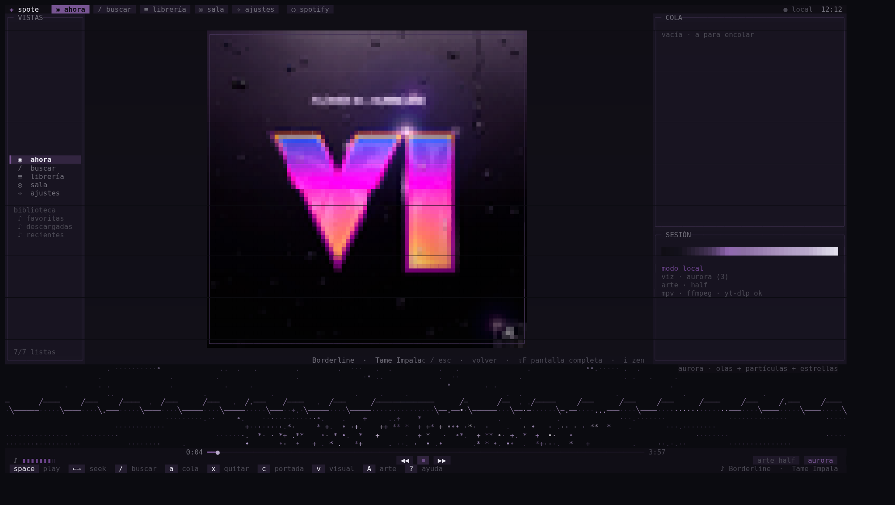
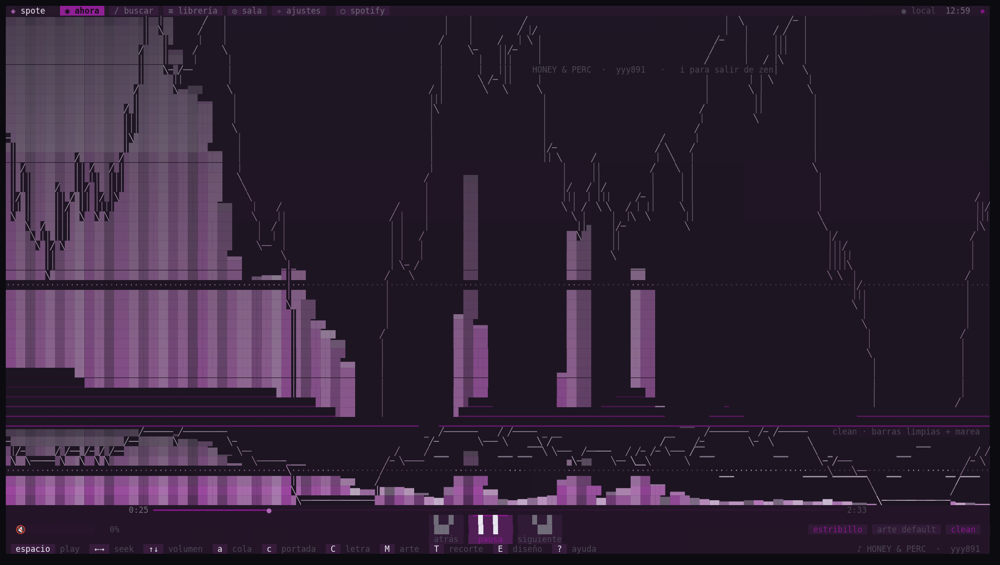

# spote

Reproductor de música en terminal. La portada del disco tiñe toda la interfaz y
los bordes, el playhead y las letras laten con el bombo, la caja y la voz.
Descarga con `yt-dlp`, reproduce con `mpv` y guarda la librería en SQLite.


## Cómo funciona

Dos binarios. `spote` es la TUI (ratatui + crossterm) y funciona sola. `spoted`
(axum + WebSocket + SQLite) es opcional: añade presencia, salas, chat y cola
compartida, escucha en `127.0.0.1:7070` y el cliente lo usa sólo si
`[server] url` está relleno.

El camino de una canción:

1. `ingest <dir>` indexa audio local, o `/` busca desde la TUI. Spotify entra
   aquí como **catálogo**: metadatos de las páginas públicas `/embed/` y de la
   API web, sin cuenta. Deezer es sólo respaldo de metadatos, nunca de audio.
2. `yt-dlp` recibe artista, título y duración reales y baja Opus. El matching
   por duración (±2 s, descarta >10 s) evita covers, remixes y vídeos con intro.
3. `mpv` reproduce por IPC. La portada se rasteriza a celdas de terminal
   (half-block truecolor, media celda, dither, braille, o imagen real en Kitty)
   y de sus colores sale la paleta del tema.
4. Un analizador FFT sobre el fichero local detecta bombo, caja, charles y voz
   y estima el BPM. De ahí salen los bordes reactivos, el transporte y el
   visualizador.
5. Las letras vienen de LRCLIB/Genius/captions (vía un checkout opcional de
   lyricbar) o del proveedor interno. Con audio local, faster-whisper alinea
   las líneas estimadas leyendo la canción por pasadas: la completa y, si el
   modelo se deja el final o una estrofa, solo esa zona con 15 s de contexto;
   de las lecturas se queda la que mejor encaja. La alineación (fonética,
   anclas y reparto) es de spote; `scripts/asr_words.py` solo transcribe
   ventanas con faster-whisper. `shift+clic` recalibra una línea a mano.

Config, librería y caché viven en XDG (`~/.config/spote`,
`~/.local/share/spote`, `~/.cache/spote`). `SPOTE_HOME` los reubica todos.

## Features

- **Arte**: modos `default` (foto en half-block / imagen Kitty), `half`,
  `pixel`, `braille` y `off`; rotación automática; portada a pantalla completa
  (`F`); fondos `cover`, `aurora`, `neural`, `glitch` y `lyrics`. Las
  miniaturas se rasterizan al tamaño exacto de cada hueco (tarjeta, cabecera
  de álbum, ficha) en vez de estirar una de 6x3. La portada de "buscar" usa
  toda la altura disponible.
- **Letras**: sincronizadas, estimadas o alineadas por ASR; editor de
  intro/outro (`T`); copia y ajuste fino por línea.
- **Visualizador**: `clean`, `aurora`, `bloom`, `inferno`; zen (`i`) y pantalla
  completa (`V`); barras, marea, llama y bloom instrumentales.
- **Catálogo**: búsqueda mixta de artistas, álbumes y pistas; fichas de artista
  y álbum; `I` importa playlists/álbumes públicos; `N`/`l`/`d` gestionan listas
  locales; `z` alterna tarjetas con portada y lista compacta.
- **Cola**: encolar (`a`), reordenar, quitar, seek, volumen, favoritas y
  progreso de descarga en la propia fila.
- **Social**: salas con cola compartida y presencia cuando hay `spoted`.
- **Ajustes en caliente**: pestaña propia y editor de diseño (`E`) para
  visibilidad, anchos, dock, centrado y tamaños; bordes arrastrables con ratón.
  Se guarda solo en `config.toml`.
- **Integraciones**: acompañante MPRIS (`--follow-spotify`), Discord Rich
  Presence, `record` (salida del sistema) y `harvest` (experimental).

`?` abre la ayuda con todas las teclas.

## Instalar y actualizar

`mpv`, `ffmpeg` y `yt-dlp` en el `PATH`; `parec` para `record`. Rust 1.82+.

```bash
git clone https://github.com/fabiomode2/spote && cd spote
./scripts/install.sh                # compila, instala en ~/.local/bin y prepara el ASR
./scripts/install.sh --lyricbar ~/Code/lyricbar   # captions de YouTube (opcional)
./scripts/update.sh                 # git pull + recompilar + instalar
```

El instalador crea un venv en `~/.local/share/spote/venv` con
`faster-whisper`, copia los scripts junto a los datos y enlaza el checkout de
lyricbar (si se pasa o si está en `../lyricbar`). No hace falta editar el
`config.toml`: la app detecta ese venv y el lyricbar enlazado. Las letras no
dependen de lyricbar: LRCLIB y Genius van dentro de spote, y el ASR alinea en
Rust. lyricbar solo añade captions de YouTube.

Al arrancar, la TUI consulta el último commit de `main` en GitHub. Si el
binario es más viejo, sale un aviso: `enter` lanza `scripts/install.sh
--update` en segundo plano y cierra la app al terminar; `esc` lo deja para
luego. `SPOTE_NO_UPDATE_CHECK=1` lo desactiva.

```bash
cargo build --release
./run.sh                                       # compila si hace falta y abre la TUI
./target/release/spote ingest ~/Music           # indexa audio local
./target/release/spote import <url> --dry-run  # catálogo sin cuenta
./target/release/spote import <url> --download # importa y baja
./target/release/spote doctor                  # comprueba dependencias
./target/release/spoted                        # backend social en :7070
```

Sin librería: `ingest` o `/` dentro de la TUI. Para exclusivas,
`spote record [--flac]` y `spote harvest` (experimental) dejan el audio en el
mismo directorio que el resto.

## Config

`~/.config/spote/config.toml`, todo opcional:

```toml
[server]
url = "http://127.0.0.1:7070"
name = "un-nombre"

[ui]
art_mode = "default"   # default | half | pixel | braille | off
viz = "clean"          # clean | aurora | bloom | inferno
fps = 120

[ui.fx]
ambient = "cover"      # off | void | aurora | neural | glitch | lyrics | cover
```

`SPOTIFY_CLIENT_ID` y `SPOTIFY_CLIENT_SECRET` activan el token de aplicación
cuando el anónimo está bloqueado. `LYRICBAR_ROOT` (o `[lyrics] root`) apunta al
checkout de lyricbar; sin él, el puente se apaga y sigue el proveedor interno.

El ASR se controla desde `[lyrics]`: `asr` (por defecto `true`), `asr_model`
(`small`), `asr_device` (`auto`) y `asr_language` (`auto`). Necesita
`faster-whisper` en el intérprete configurado (`python`) y `ffmpeg`; si falta
algo, la letra estimada se muestra igual y no se reintenta en bucle.

<p>
  
  
</p>

Más capturas en `docs/screenshots/`.

## Documentación

- `idea.md` — producto, arquitectura y decisiones.
- `docs/arquitectura.md` — módulos, layout, álbumes y mapa de audio.
- `docs/effects.md` — especificación de los efectos.
- `docs/rework.md` — estado y limitaciones conocidas.
- `scripts/frame.py` — captura la TUI en un pty y la vuelca a HTML;
  `scripts/html2png.py` lo convierte en PNG con un navegador headless.
