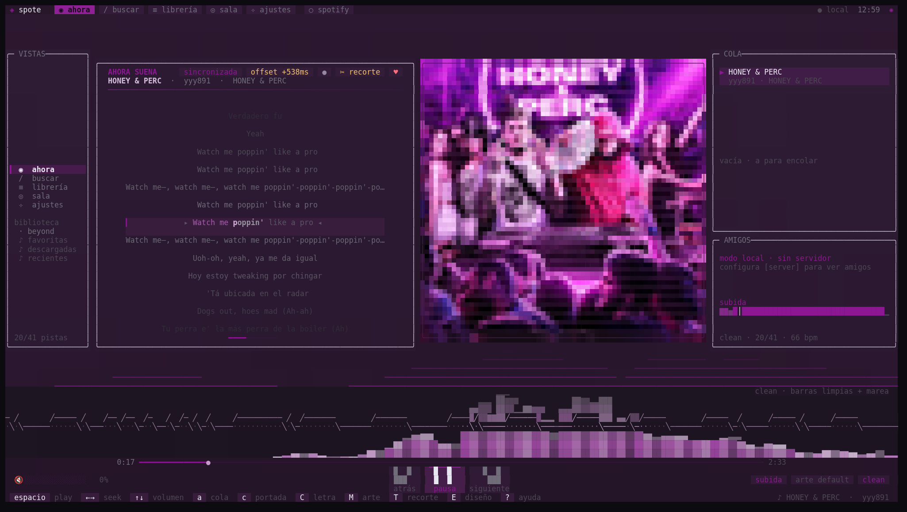

# spote

Reproductor de música en terminal. La portada del disco tiñe la interfaz y los
bordes, el playhead y las letras reaccionan al audio. La TUI está en Rust y tira
de `mpv` para reproducir, `yt-dlp` para bajar y SQLite para la biblioteca.



## Instalar

```bash
git clone https://github.com/fabiomode2/spote && cd spote
./scripts/install.sh
spote
```

Hacen falta Rust 1.82+ para la TUI (1.85+ si compilas `spote-mini`), `mpv`, `ffmpeg` y `yt-dlp` en el `PATH`.
En Kitty, WezTerm, Ghostty y Konsole reciente las portadas y fotos de artista
se dibujan como imágenes reales; en el resto hay fallback half-block.
`SPOTE_IMAGES=off` fuerza el fallback y `SPOTE_IMAGES=kitty` lo activa a mano. El instalador
deja los binarios en `~/.local/bin`, crea el venv con `faster-whisper` y copia
los scripts. Las letras no necesitan nada más: LRCLIB, Genius, captions de
YouTube y ASR van dentro.

Para actualizar: `./scripts/update.sh`, o desde el aviso de versión que sale en
la propia TUI.

## Qué hace

- **Arte**: portada en half-block, dither, braille o imagen real en Kitty. La
  paleta del tema sale de la carátula.
- **Visuales**: catálogo `clean`, `aurora`, `bloom`, `inferno`, `crt`, `lcd`,
  `rack`, `braille` y `stage`. La rotación de `v` se elige en `e` (por defecto
  `clean`, `aurora`, `bloom`, `crt` y `braille`; `lcd/rack/stage` quedan a
  mano). `V` los pone a pantalla completa.
- **Letras**: Genius es la referencia de texto. LRCLIB, lrcmux y las captions
  de YouTube solo aportan tiempos cuando su letra coincide. Si no hay una
  fuente fiable, se muestra “sin letra verificada”. El chip `inv` (o `G` en el
  foco de letra) permite activar/desactivar las letras generadas con
  captions/ASR; por defecto están apagadas. La barra permite zoom (`A−`/`A+`),
  ajuste de ±100/±250 ms por pista, scroll manual y volver a la línea actual
  (`⟲`/`home`). `⌕`/`b` abre una búsqueda manual: lista las versiones de
  LRCLIB, las previsualiza y deja aceptar a mano la que sea correcta. `⟳`
  descarta la caché y busca otra letra.
- **Karaoke**: palabra a palabra, frases largas en dos filas y la última palabra
  se llena antes de cambiar de línea.
- **Ficha de artista y álbum**: se abren como páginas con historial, en una
  columna lateral redimensionable o a todo el ancho (`modo de detalle`). El
  artista muestra su discografía en una tira horizontal y sus canciones
  populares; el álbum, portada, ficha y tracklist. `esc` vuelve a la página
  anterior y la × cierra el documento.
- **Pestañas e historial**: secciones fijas en el lateral y pestañas de
  documentos arriba. Abrir artista/álbum apila una página; `esc` vuelve,
  `alt+←/→` recorre el historial, `ctrl+w` cierra y `ctrl+tab` cambia de
  pestaña.
- **Barra de canción actual**: portada, título, todos los artistas (principal
  y features), álbum, corazón de favorita y estado de reproducción.
- **Fondo mosaico**: la portada de la pista actual detrás de **toda** la
  interfaz, incluidos el chrome, el transporte y la franja de efectos. Modo
  `half` con paleta por defecto (`plain`, `dither` y `braille` también),
  opacidad propia, movimiento en deriva, filas, columnas, diagonal o auto
  reactivo (calma/build/drop) y saltos al bombo. Los paneles tienen
  transparencia real y borde configurable (línea o color reactivo); ambos ajustables.
- **Búsqueda y reproducción**: Spotify y Deezer como catálogo, sin cuenta. El
  audio sale de `yt-dlp`. Si una pista no está descargada, se resuelve una URL
  y suena al momento mientras se guarda la copia local. Los títulos simbólicos
  (`(_8(|)`) conservan su núcleo para no confundirlos con homónimos. `I` importa
  playlists y álbumes.
- **Cola y listas**: encolar, reordenar, descargar, favoritas y playlists
  locales. `z` alterna tarjetas con portada y lista compacta. `/` en la
  biblioteca abre un filtro inline por título, artista o álbum.
- **Discos guardados**: pestaña `discos` con portadas, orden por artista y
  buscador (`/`); `z` alterna tarjetas y lista compacta. Abrir un disco lo
  apila en el historial.
  `X` sobre un disco (o ⇧clic en la ×) pide confirmación y quita **todas sus
  canciones** de la biblioteca sin borrar el audio; dentro de la ficha, `x`
  quita solo la pista seleccionada. `d` sobre una lista también pide
  confirmación: por defecto borra la lista y conserva sus canciones, y `t` en
  el diálogo permite quitarlas también. `spote dedupe` fusiona duplicados de
  forma explícita, con `--dry-run` y backup previo.
- **Artistas completos**: las pistas guardan todos los artistas de Spotify
  (principal + features) y `album_artist` para no fragmentar discos. Las
  pistas antiguas se reprocesan en segundo plano; `spote artistas` lo relanza
  a mano.
- **Paletas**: `P` abre el laboratorio de paletas derivadas de la portada
  (vibrante, pastel, complementaria, analógica, mono, duotone y contraste),
  con preview y override por álbum.
- **Wrapped**: `W` abre un resumen de escucha con horas, reproducciones,
  artistas, canciones, discos y actividad por meses. `a` alterna entre el
  año actual y todo el tiempo. Manteniendo `shift` aparece una `×` en cada
  fila para ocultar varias seguidas de un clic.
- **Media del sistema**: MPRIS bidireccional. spote aparece como reproductor
  en el escritorio (teclas multimedia, OSD, widgets) y `t` sigue lo que suene
  en Spotify, SoundCloud, VLC o cualquier otro reproductor MPRIS.
- **Mini reproductor**: `w` abre `spote-mini`, una ventana pequeña siempre
  encima con la estética del transporte de la TUI: tipografía monoespaciada,
  barra de bloques, controles pixel-art y la portada del disco sonando. El
  visual de la ventana grande ocupa todo el fondo y el chip `viz` cambia de
  preset desde el propio mini; también se lanza con `spote mini`.
- **Audio ajustable**: pestaña `♫ audio` con ecualizador gráfico de 10 bandas,
  preamp, normalizador en directo y limitador. La nivelación entre pistas mide
  el audio completo y deja todas las canciones al mismo volumen; se aplica en
  caliente y se puede apagar desde la propia pestaña o desde ajustes. Dentro de
  la pestaña, `←`/`→` cambia de control y `↑`/`↓` ajusta el valor.
- **Amigos y Tunebat**: el panel de amigos muestra, además de la presencia,
  los datos de **Tunebat** de la pista sonando (`[ui] tunebat = false` lo
  desactiva): BPM, tonalidad, Camelot,
  energy, danceability, happiness y popularidad. Se consulta solo al cambiar
  de canción, se cachea en memoria y tiene respaldo compacto en paneles bajos.
- **Salas**: `spoted` añade presencia, chat y cola compartida. En la TUI, `s`
  abre la pestaña de salas; `n` crea una (Tab alterna pública/privada), `a`
  añade amigos, `i` invita a la sala, `x` expulsa, `t` abre el chat y `L` sale.
  La API exige una clave de cliente por persona (`X-Spote-Key`), las sesiones
  están atadas a esa clave y caducan. Ver [`docs/social.md`](docs/social.md).
- **Cuenta y sync**: la misma clave en PC y Android identifica la misma cuenta;
  `spoted` sincroniza favoritas, escuchas y playlists por revisiones, sin subir
  audio ni rutas locales.
- **Layout**: `E` edita paneles, anchos, dock y tamaños. Se guarda solo en
  `config.toml`. En **ajustes**, `/` abre un buscador inline por nombre,
  sección o ayuda, igual que en discos y biblioteca.

Los vídeos con verificación de edad necesitan una cuenta de YouTube ya
verificada. Si configuras `[stream] cookies_from_browser`, spote reintenta el
streaming y la descarga con las cookies de ese navegador. Para este tipo de
vídeos también hace falta tener la edad verificada en la cuenta; sin eso
YouTube no entrega ningún formato.

## Atajos

| | | | |
|---|---|---|---|
| `space` | play/pausa | `a` | encolar |
| `n` / `p` | siguiente / anterior | `f` | favorita |
| `←` `→` | seek ±5 s | `g` | artista |
| `/` | buscar · filtro en biblioteca, discos o ajustes | `T` | recortar intro/outro |
| `u` | bucle de la pista | `F` | portada a pantalla completa |
| `S` | aleatorio on/off | `o` | bucle: off / todo / una |
| `c` / `C` | portada / letra | `V` | visualizador a pantalla completa |
| `E` | editor de diseño | `Esc` | atrás |
| `A` | pestaña de audio | `w` | mini reproductor |
| `P` | menú de paletas | `O` | abrir álbum de la fila |
| `ctrl+w` | cerrar documento | `ctrl+tab` | cambiar de pestaña |
| `X` | quitar de la biblioteca | `t` | seguir el sistema (MPRIS) |
| `q` | salir de spote | `?` | ayuda |

## Cómo funciona

```
audio local ──▶ mpv (IPC) ──▶ FFT ──▶ UI reactiva
     │                         │
     └──▶ SQLite ◀─────────────┘   librería · playlists · letras · historial
```

Config, datos y caché en XDG (`~/.config/spote`, `~/.local/share/spote`,
`~/.cache/spote`). `SPOTE_HOME` los reubica todos. Para el VPS hay
`Dockerfile`, `docker-compose.yml` y `deploy/nginx/spote.conf`; el paso a paso
está en [`docs/social.md`](docs/social.md).

```toml
[server]
url = "https://spote.example.com"  # vacío = modo local, sin salas
name = "ana"
invite = "…"           # la invitación del grupo
client_key = "…"       # clave personal; sin ella la API responde 401
token = ""             # se rellena tras el login

[ui]
art_mode = "default"   # default | half | pixel | braille | off
viz = "clean"          # clean | aurora | bloom | inferno | crt | lcd | rack | braille | stage
fps = 60               # frames de la UI (20-60)
fx_fps = 60            # ritmo de los efectos; el canvas a pantalla completa va a este ritmo
tunebat = true         # BPM/tonalidad de la pista en el panel de amigos (API no oficial)

panel_opacity = 72     # 55-100; transparencia real de paneles
chrome_opacity = 40    # 0-100; barra superior y navegación
bottom_opacity = 92    # 0-100; transporte, nowbar y hint (sólido por defecto)
zen_viz_pct = 55       # altura del efecto en zen (30-100)
panel_border = "line"  # line | color | none
border_opacity = 70    # 0-100, independiente del relleno
nav_position = "auto"  # auto | side | top | both
detail_mode = "docked" # docked | expand | auto
lyrics_scenario = "off" # off | lateral | centered | behind | mosaic
effects_enabled = ["clean", "aurora", "bloom", "crt", "braille"]

[ui.fx]
ambient = "cover"      # capa extra: off | void | aurora | neural | glitch | lyrics
ambient_opacity = 16   # 0-50 %
backdrop = "mosaic"    # mosaic | gradient | off
mosaic_mode = "half"   # half | plain | dither | braille
mosaic_opacity = 22    # 5-50 %
mosaic_motion = "auto" # auto | drift | rows | columns | diagonal | rotate
mosaic_auto = true     # reacciona a la energía de la canción
mosaic_speed = 4       # 1-10
mosaic_beat = true     # salta con el bombo

[player]
streaming = true       # resuelve YouTube y suena mientras descarga
stream_cache = true    # guarda la copia local al terminar (tras unos segundos de escucha)

[stream]
cookies_from_browser = ""  # firefox | chrome | brave | chromium | edge
cookies_file = ""          # cookies.txt exportado; tiene prioridad si no está vacío

[playback]
repeat = "off"         # off | all | one
shuffle = false

[audio]
enabled = true
eq_enabled = true
bands = [0, 0, 0, 0, 0, 0, 0, 0, 0, 0]   # dB, 31 Hz … 16 kHz
preamp_db = 0
normalizer = "off"     # off | dynamic | loudnorm (respaldo en directo)
normalizer_strength = 0.5
normalize_tracks = true # iguala el volumen de todas las pistas
limiter = false

[lyrics]
asr = true
allow_generated = false # captions/ASR pueden inventar letra (chip inv)
asr_model = "small"    # tiny | base | small | medium | large-v3
```

## Comandos

```bash
spote ingest ~/Music                            # indexa audio local
spote import <url-spotify> --download           # importa y baja
spote dedupe --dry-run                          # lista duplicados sin tocar nada
spote dedupe --yes                              # fusiona con backup previo
spote doctor                                    # comprueba dependencias
spote record [--flac]                           # graba lo que suena
spoted                                          # backend social (requiere secretos)
spoted keygen ana bea                           # genera invitación y claves
docker compose up -d --build                    # spoted + SQLite en un volumen
```

## Android

Hay un cliente nativo en `android/`: Compose para la UI, Media3 para reproducir
y el mismo core Rust por UniFFI para biblioteca, letras y salas. Importa audio
del teléfono, busca y descarga de YouTube on-device, y se actualiza desde las
releases de GitHub.

```bash
./scripts/build-android-lib.sh
cd android && ./gradlew :app:assembleDebug
```

- `android/README.md` — build, arquitectura, modo mock y limitaciones.
- `docs/screenshots/android/` — capturas reales de Compose (Roborazzi).
- `spote setup` — QR/enlace para configurar el móvil desde el desktop;
  `spoted qr <url> <key> <invite>` hace lo mismo desde el servidor.

## Más

- `idea.md` — producto, arquitectura y decisiones.
- `docs/social.md` — backend `spoted`, seguridad, Docker y nginx.
- `docs/arquitectura.md` — módulos, layout y mapa de audio.
- `docs/effects.md` — especificación de los efectos.
- `docs/rework.md` — estado y limitaciones.
- `docs/screenshots/` — más capturas.
