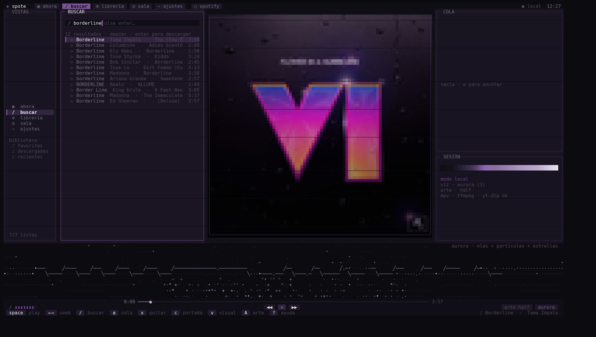
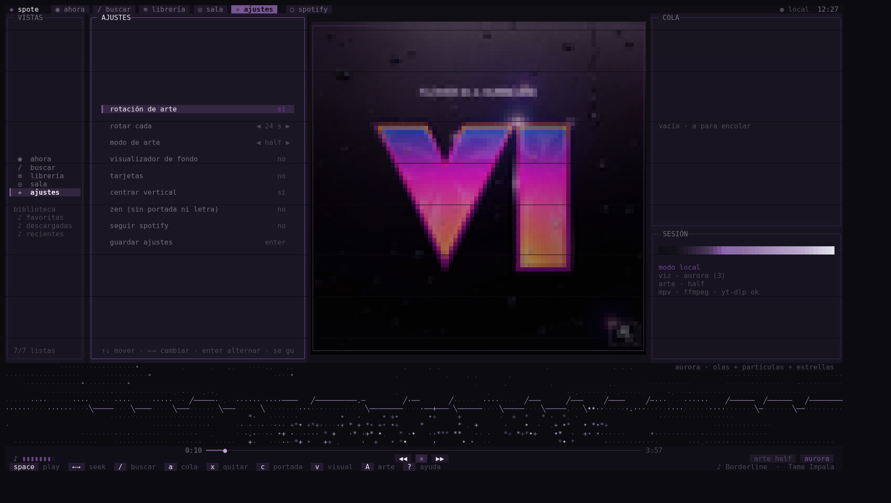
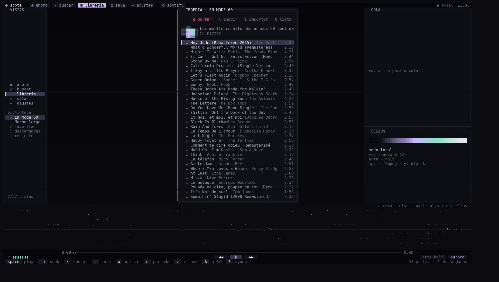
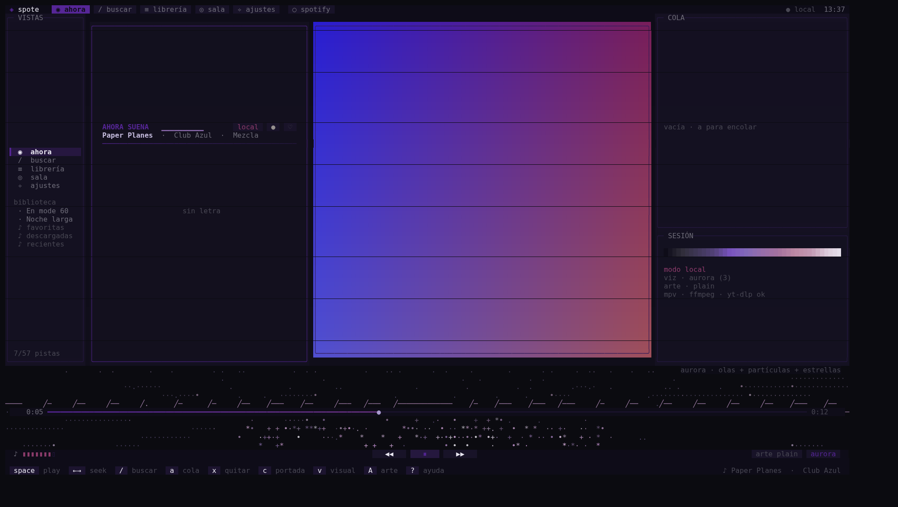

# spote

Reproductor de música privado con una TUI que reacciona a la portada del álbum.
Cliente local (descarga con `yt-dlp`, reproduce con `mpv`) + backend social
(`spoted`) para presencia, salas y cola compartida.

```
crates/
  protocol/   contrato compartido (TrackRef, salas, mensajes WS)
  core/       config · librería SQLite · descarga · mpv · letras · portada · audio
  server/     spoted: axum + SQLite + WebSocket
  tui/        spote: ratatui + crossterm
```


 · 

 · 

## Requisitos

`mpv`, `ffmpeg` y `yt-dlp` en el `PATH`. Para el visualizador con audio del
sistema, `parec` (PipeWire/PulseAudio). Rust 1.82+.

## Compilar y ejecutar

```bash
./run.sh                               # compila si hace falta y abre la TUI
./run.sh --follow-spotify              # modo acompañante de Spotify
cargo build --release
./target/release/spote                 # TUI (modo local)
./target/release/spote --follow-spotify # acompaña al cliente oficial por MPRIS
./target/release/spote ingest ~/Music   # indexa audio local
./target/release/spote import <url-spotify> --dry-run  # catálogo sin cuenta
./target/release/spote import <url-spotify> --download # importa y baja
./target/release/spote record [--flac]  # graba la salida del sistema
./target/release/spote doctor           # comprueba dependencias
./target/release/spoted                 # backend social en :7070
```

Sin música en la librería: `spote ingest <carpeta>` o busca con `/` dentro de
la TUI (descarga con yt-dlp).

## Config

`~/.config/spote/config.toml` (todo opcional):

```toml
[server]
url = "https://spote.example.com"
name = "tu-nombre"
invite = "spote"

[ui]
art_mode = "plain"  # default | half | pixel | braille | off
art_rotate = false  # rotación automática (incluye half)
art_rotate_off = false  # añadir off a la rotación
viz = "clean"       # clean, aurora, bloom, inferno (franja inferior)
fps = 120
lyrics_size = 1     # 0 compacta, 1 normal, 2 grande

[ui.layout]          # también se edita en caliente con `E`
nav = true
queue = true
info = true
viz = true
transport = true
hint = true
vcenter = true
vcenter_pct = 82
nav_width = 19
side_width = 42
viz_height = 8
transport_height = 4

[ui.fx]
ambient = "cover"    # off | void | aurora | neural | glitch | lyrics | cover
ambient_opacity = 16
instrument_borders = true
edge_flame = true
bloom_play = true
clean_spill = true
glitch_panels = false
```

## Teclas

`space` play/pausa · `←/→` seek ±5 s (`shift` ±30 s) · `↑/↓` volumen en
«ahora» y selección en listas · `J/K` mover selección siempre · `enter`
reproducir / abrir álbum / unirse a sala · `a` encolar · `x` quitar de la
cola · `shift ↑/↓` o `, .` mover por la cola · `f` favorita · `/` buscar ·
`tab` cambiar vista · `t` seguir Spotify · `v` siguiente visualización ·
`V` visualización a pantalla completa · `b` visualizador de fondo ·
`c` portada a todo el centro · `C`/`l` letra a todo el centro · `e` capas ·
`M` siguiente modo de arte · `E` editor de diseño · `g` perfil de artista ·
`r` rotación automática del arte (default/half/pixel/braille) · `z` lista compacta / tarjetas ·
`F` portada a pantalla completa · `m` mute · `y` copiar letra · `N` crear
lista · `I` importar lista o álbum de Spotify · `l` añadir a lista · `d`
borrar lista / bajar álbum · `[` `]` cambiar de filtro/lista · `Delete` o
clic derecho: acciones de la pista · `T` o el chip `✂ recorte` abren el editor
de intro/outro · `Home` / `End` marcan los puntos · `Backspace` lo quita ·
`alt/ctrl/shift+clic` o clic derecho en una línea de letra la sincroniza con
la posición actual · `?` ayuda.

Los nombres de artista y álbum son clicables en la biblioteca, la cola, la
búsqueda y «ahora»: abren su ficha dentro de spote. En la búsqueda aparecen
artistas, álbumes y canciones mezclados; `z` alterna tarjetas con portada o
lista compacta.

## Extras

- **Arte**: `default` (foto literal en half-block truecolor), `half` (media
  celda con la paleta, sin imagen Kitty), `pixel` (dither) y `braille` (tinta
  adaptativa). `off` apaga la portada. La rotación automática viene apagada;
  `M` cambia a mano y `r` la activa con default/half/pixel/braille. Activa
  `art_rotate_off` para que `off` también participe. En Kitty, `default`
  transmite la portada original como imagen real a resolución completa; en
  otros terminales queda el half-block como fallback. `F` la abre a pantalla
  completa sin tapar el transporte; `V` es el visualizador.
- **Miniaturas**: `[ui] thumb_mode = "plain" | "palette" | "off"` (o el ajuste
  «efecto miniaturas»): foto fiel (por defecto), paleta del tema o sin
  miniatura.
- **Tarjetas**: `z` muestra la lista y la cola en bloques de 3 filas con
  miniatura de portada, artista y estado.
- **Instrumentos**: el analizador detecta bombo, caja, charles y voz; los
  bordes, la portada, el playhead y las letras laten con ellos, y el BPM se
  estima con los bombos.
- **Letras de lyricbar**: si existe `/home/fabio/Code/lyricbar`, spote usa su
  motor (LRCLIB + Genius + captions) vía `scripts/lyricbar_bridge.py`; si hay
  audio local, alinea las líneas con faster-whisper (ASR) para que las letras
  estimadas de Genius no vayan a ojo. `[lyrics] bridge = false` lo desactiva.
- **Fondo y efectos**: `[ui.fx] ambient` elige `void`, `aurora`, `neural`,
  `glitch`, `lyrics` (la letra como textura) o `cover` (la portada fundida a
  pantalla completa, ahora por defecto). Se mezcla solo el fondo de las celdas:
  el texto sigue legible. Los bordes laten con bombo/caja/charles/voz,
  `inferno` asoma como brasa continua en el borde inferior, `bloom` hace de
  halo del play y `clean` mezcla barras suaves con una marea sobre los paneles.
- **Zen**: `i` esconde portada y letra y deja la visualización a pantalla
  completa.
- **Catálogo**: la búsqueda pide metadatos a Spotify (Deezer solo como
  respaldo de metadatos si Spotify bloquea el token) y descarga con yt-dlp
  usando artista/título/duración reales. La portada se prefiere de Spotify;
  la miniatura local de yt-dlp queda como respaldo.
- **Ajustes**: pestaña propia (`tab` hasta `ajustes`) para arte, presets y
  fondos ambientales, opacidad, bordes instrumentales, llama, bloom, derrame
  de clean, glitch en paneles, tamaño de letra, tarjetas, barra de progreso,
  controles, Spotify y acceso al editor de diseño. Todo se guarda solo.
- **Diseño**: `E` abre el editor en caliente: visibilidad, ancho/alto, dock
  izquierda/derecha, proporción cola/info, tamaño de portada y centrado
  vertical (bloque completo, no el texto). Los bordes de los paneles se
  arrastran con el ratón. Todo se guarda solo.
- **Transporte ajustable**: `[ui] progress_in_viz` pone la barra centrada en la
  franja del visualizador; `bar_width_pct` (55-100) la ensancha y
  `button_pad` (1-4) da más aire a los iconos.
- **Listas**: `N` crea una lista con nombre, descripción y portada (URL o
  automática, la de la primera pista); `l` añade la pista seleccionada; `d`
  borra la lista abierta; `[`/`]` recorren filtros y listas.
- **Importar listas**: `I` pega una URL pública de Spotify (playlist o álbum)
  y crea la lista local con sus pistas. Deezer solo se usa como respaldo de
  metadatos de búsqueda, nunca para importar listas.
- **Álbumes**: no hay pestaña aparte. Al pulsar un álbum en la búsqueda, en
  la biblioteca o en una ficha de artista se abre su página con portada,
  tracklist, `d` para bajar el álbum entero y `s` para guardarlo como lista.
  También se puede importar una URL de álbum de Spotify con `I`.
- **Amigos**: el panel donde estaba «sesión» muestra presencia y lo que escucha
  cada amigo; la info técnica vive ahora en la vista de sala.
- **Descargas**: el paso y el porcentaje salen en el transporte y en la fila
  de la pista; el panel lateral muestra el título en una línea y la barra con
  el porcentaje debajo, con un spinner animado. La portada descargada se
  registra sola.
- **Sala** usa el mismo reparto de columnas que el resto de vistas.
- **Clics en la cola**: un solo clic en `×` quita la pista (antes hacía falta
  doble clic porque la fila tapaba el botón). La cola muestra arriba lo que
  está sonando.
- **Letras**: matching más estricto con variantes de título/artista y
  duración; las líneas que son solo adlibs entre paréntesis no roban la línea
  activa. `Home`/`End` recortan intro/outro de un vídeo y `shift+clic` alinea
  una línea con la reproducción actual.
- **Rich Presence**: `[discord]` con el Application ID de tu app de Discord;
  `./target/release/spote discord --id <id> --save` lo prueba y lo guarda.

## Documentación

- `idea.md` — producto, arquitectura, decisiones y estado.
- `docs/arquitectura.md` — mapa de módulos, layout, álbumes, artistas,
  contexto, mapa de audio y recetas para añadir vistas/ajustes.
- `docs/effects.md` — especificación del port de efectos de `cli-viz`.
- `docs/rework.md` — estado de esta revisión y limitaciones conocidas.
- `scripts/frame.py` — captura la TUI en un pty y la convierte en HTML
  (para revisar el diseño sin abrir una terminal).
