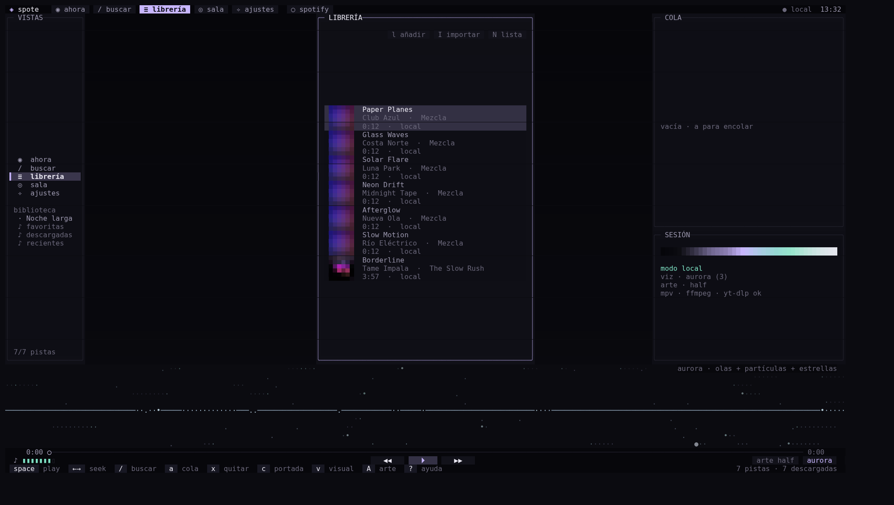

# spote

Reproductor de música privado con una TUI que reacciona a la portada del álbum.
Cliente local (descarga con `yt-dlp`, reproduce con `mpv`) + backend social
(`spoted`) para presencia, salas y cola compartida.

```
crates/
  protocol/   contrato compartido (TrackRef, salas, mensajes WS)
  core/       config · librería SQLite · descarga · mpv · letras · portada · audio
  server/     spoted: axum + SQLite + WebSocket
  tui/        spote: ratatui + crossterm
```




 · 

## Requisitos

`mpv`, `ffmpeg` y `yt-dlp` en el `PATH`. Para el visualizador con audio del
sistema, `parec` (PipeWire/PulseAudio). Rust 1.82+.

## Compilar y ejecutar

```bash
./run.sh                               # compila si hace falta y abre la TUI
./run.sh --follow-spotify              # modo acompañante de Spotify
cargo build --release
./target/release/spote                 # TUI (modo local)
./target/release/spote --follow-spotify # acompaña al cliente oficial por MPRIS
./target/release/spote ingest ~/Music   # indexa audio local
./target/release/spote import <url-spotify> --dry-run  # catálogo sin cuenta
./target/release/spote import <url-spotify> --download # importa y baja
./target/release/spote record [--flac]  # graba la salida del sistema
./target/release/spote doctor           # comprueba dependencias
./target/release/spoted                 # backend social en :7070
```

Sin música en la librería: `spote ingest <carpeta>` o busca con `/` dentro de
la TUI (descarga con yt-dlp).

## Config

`~/.config/spote/config.toml` (todo opcional):

```toml
[server]
url = "https://spote.example.com"
name = "tu-nombre"
invite = "spote"

[ui]
art_mode = "half"   # half | dither | braille | off
viz = "aurora"      # aurora, inferno, void, bloom, glitch, clean, neural
fps = 60
```

## Teclas

`space` play/pausa · `←/→` seek ±5 s (`shift` ±30 s) · `↑/↓` selección ·
`enter` reproducir / unirse a sala · `a` encolar · `x` quitar de la cola ·
`shift ↑/↓` o `, .` mover por la cola · `f` favorita · `/` buscar (en la vista
de buscar ya escribes directamente) · `tab` cambiar vista · `t` seguir Spotify
(también el chip `○ spotify` de la barra) · `v` siguiente visualización ·
`V` visualización a pantalla completa · `b` visualizador de fondo ·
`c` portada a todo el centro · `C` letra a todo el centro · `e` capas ·
`A` siguiente modo de arte · `r` rotación automática del arte · `z` lista
compacta / tarjetas · `F` portada a pantalla completa · `m` mute · `y` copiar
letra · `?` ayuda.

## Extras

- **Arte rotando**: cada 24 s cambia entre `half`, `dither`, `braille` y
  `gradient` con disolución progresiva (`r` lo activa/desactiva, `A` cambia a
  mano).
- **Tarjetas**: `z` muestra la lista y la cola en bloques de 3 filas con
  miniatura de portada, artista y estado.
- **Instrumentos**: el analizador detecta bombo, caja, charles y voz; los
  bordes, la portada, el playhead y las letras laten con ellos, y el BPM se
  estima con los bombos.
- **Letras de lyricbar**: si existe `/home/fabio/Code/lyricbar`, spote usa su
  motor (LRCLIB + Genius + captions) vía `scripts/lyricbar_bridge.py`;
  `[lyrics] bridge = false` lo desactiva.
- **Visualizador de fondo**: `b` pinta los efectos por toda la TUI, con los
  paneles ligeramente translúcidos.
- **Zen**: `i` esconde portada y letra y deja la visualización a pantalla
  completa.
- **Catálogo**: la búsqueda pide metadatos a Spotify (o Deezer si el token
  anónimo está bloqueado) y descarga con yt-dlp usando artista/título/duración
  reales; la lista de resultados ya no sale de yt-dlp.
- **Ajustes**: pestaña propia (`tab` hasta `ajustes`) para el modo de arte, los
  segundos de rotación, tarjetas, fondo, centrado vertical, zen y Spotify.
- **Centrado vertical**: `[ui] vcenter = true` centra el contenido de los
  paneles en vez de pegarlo arriba.
- **Sala** usa el mismo reparto de columnas que el resto de vistas.
- **Clics en la cola**: un solo clic en `×` quita la pista (antes hacía falta
  doble clic porque la fila tapaba el botón).

## Documentación

- `idea.md` — producto, arquitectura, decisiones y estado.
- `docs/effects.md` — especificación del port de efectos de `cli-viz`.
- `scripts/frame.py` — captura la TUI en un pty y la convierte en HTML
  (para revisar el diseño sin abrir una terminal).
