# spote Android — capturas de la UI

Capturas reales de Compose renderizadas con Roborazzi (JVM, sin emulador) usando
datos mock. La carpeta hermana `android/` contiene el proyecto; las capturas se
regeneran con:

```bash
cd android
JAVA_HOME=/usr/lib/jvm/java-21-openjdk-amd64 ./gradlew :app:recordRoborazziDebug \
  --tests 'dev.spote.app.screenshot.ScreenShotsTest'
```

| | |
|---|---|
| 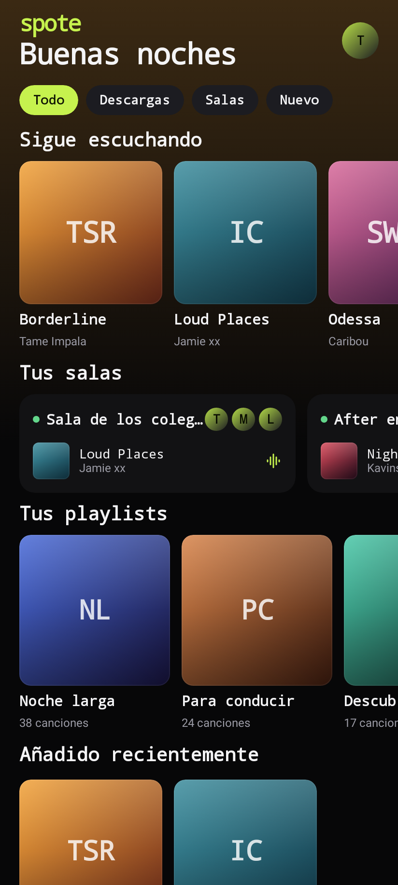 | 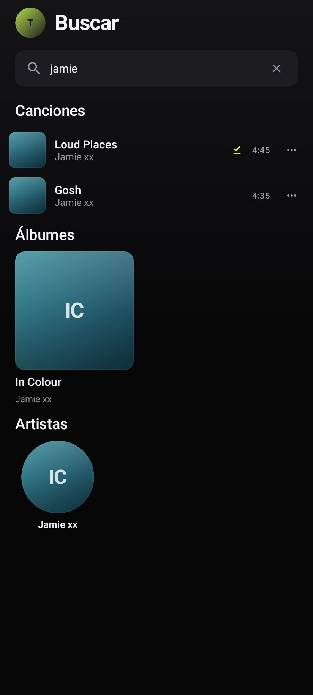 |
| 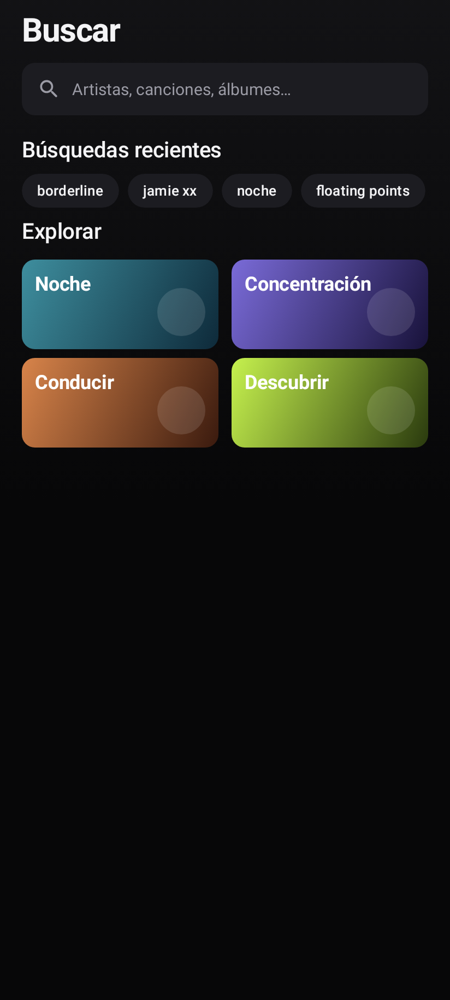 | 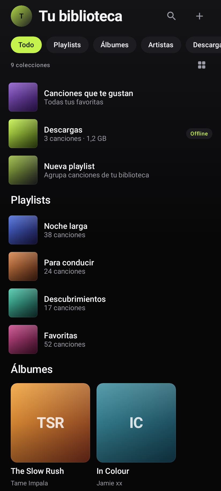 |
| 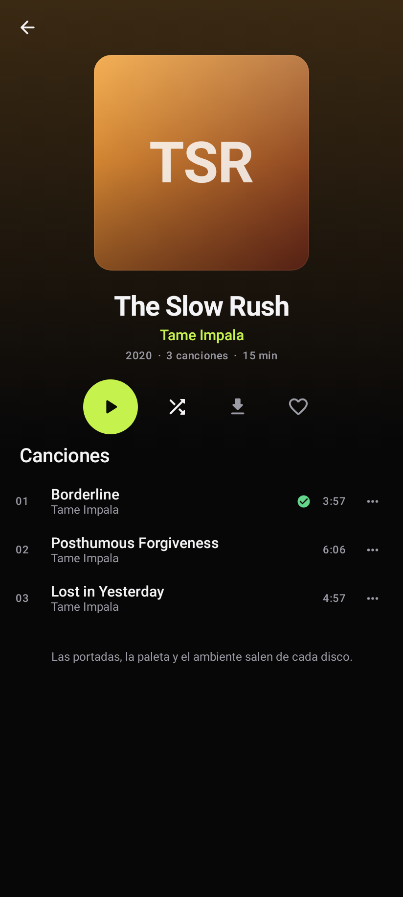 | 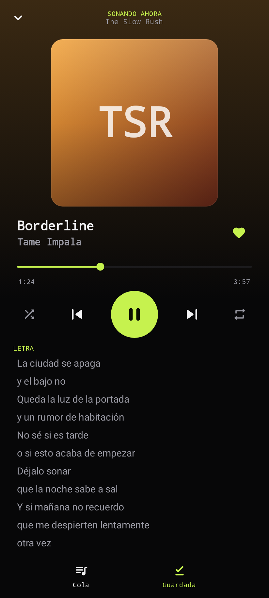 |
| 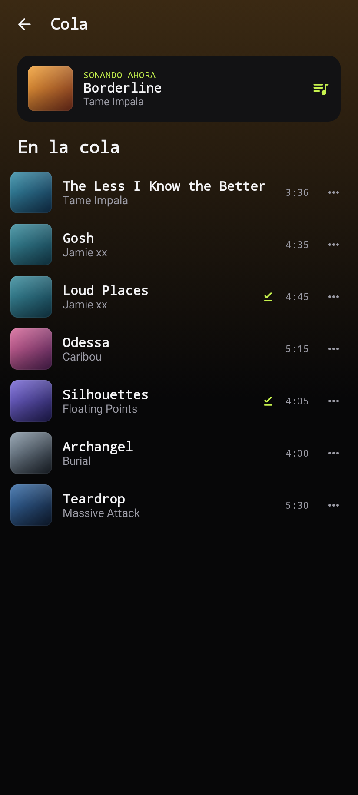 | 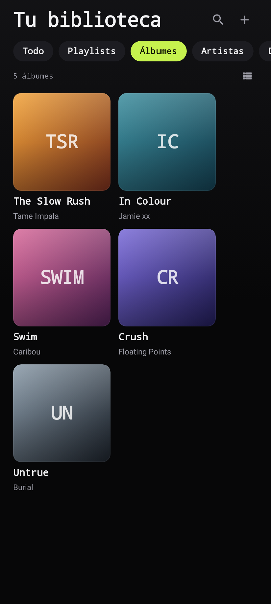 |
| 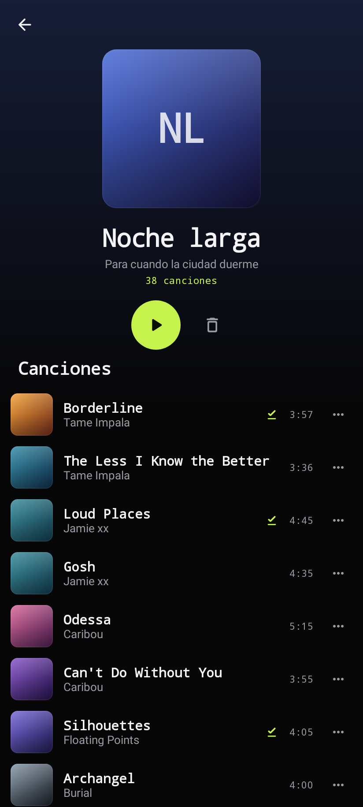 | 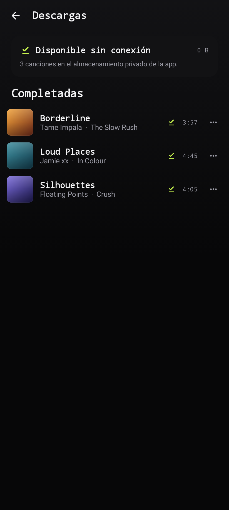 |
| 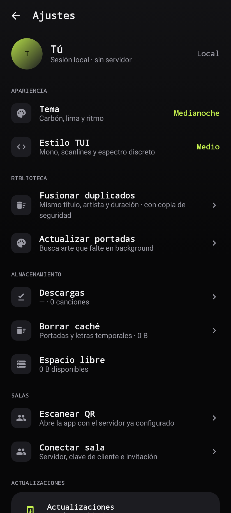 | 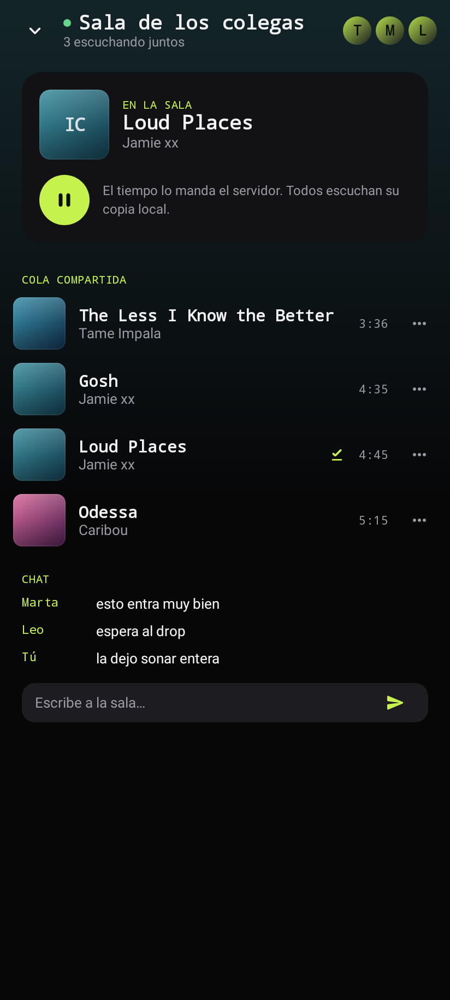 |
| 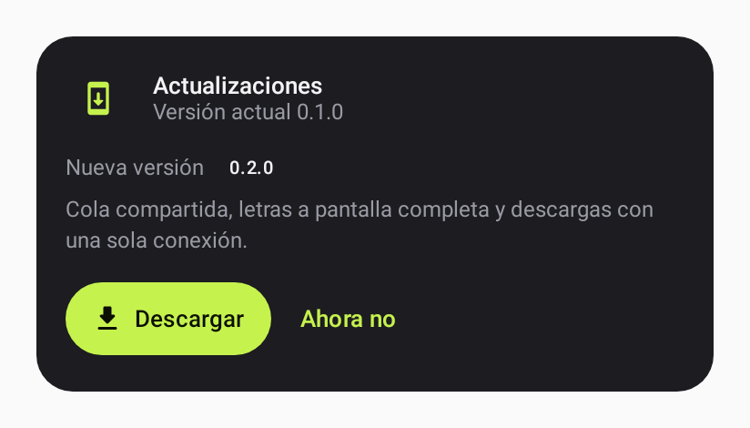 | 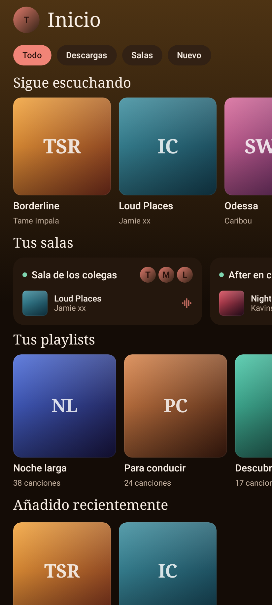 |
| 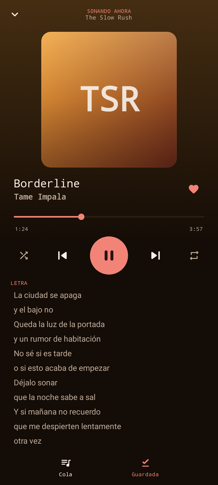 | 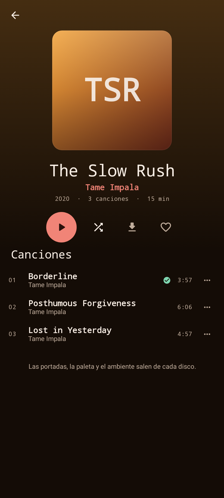 |
| 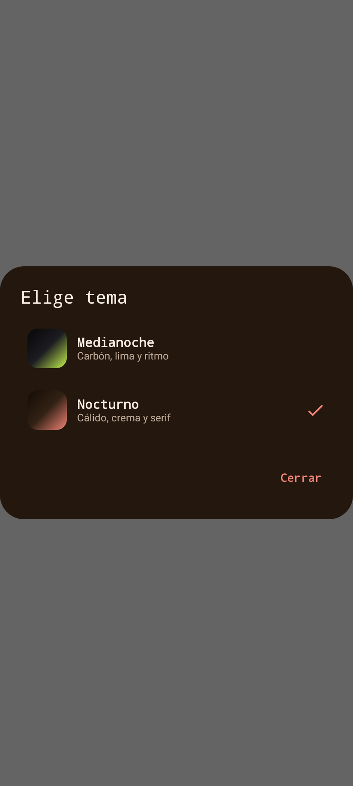 | 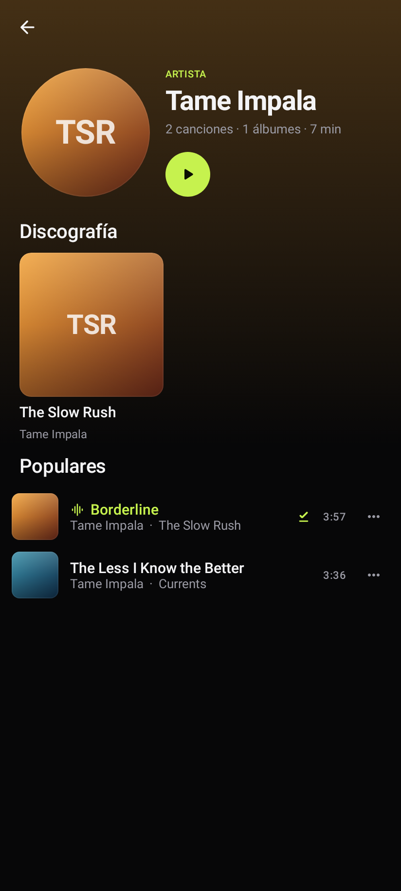 |
| 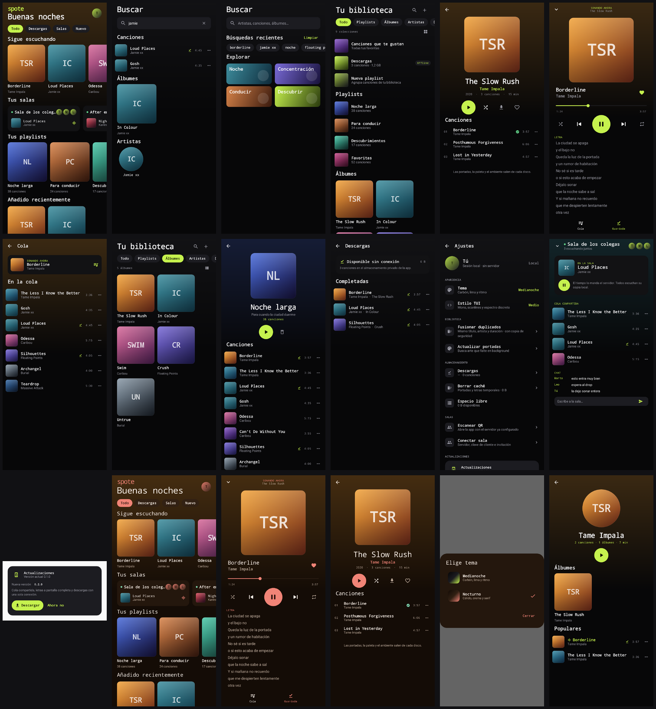 | |
